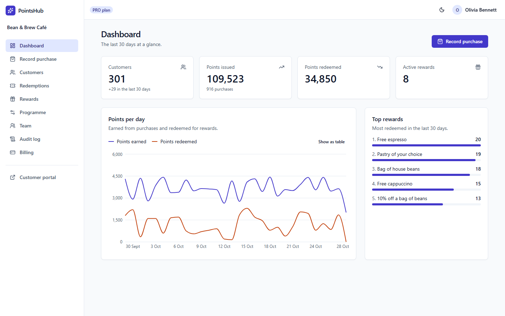
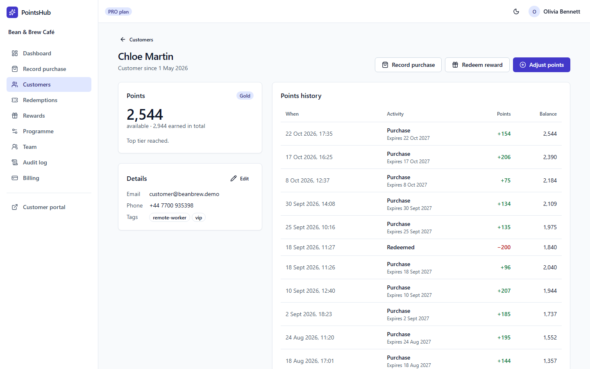
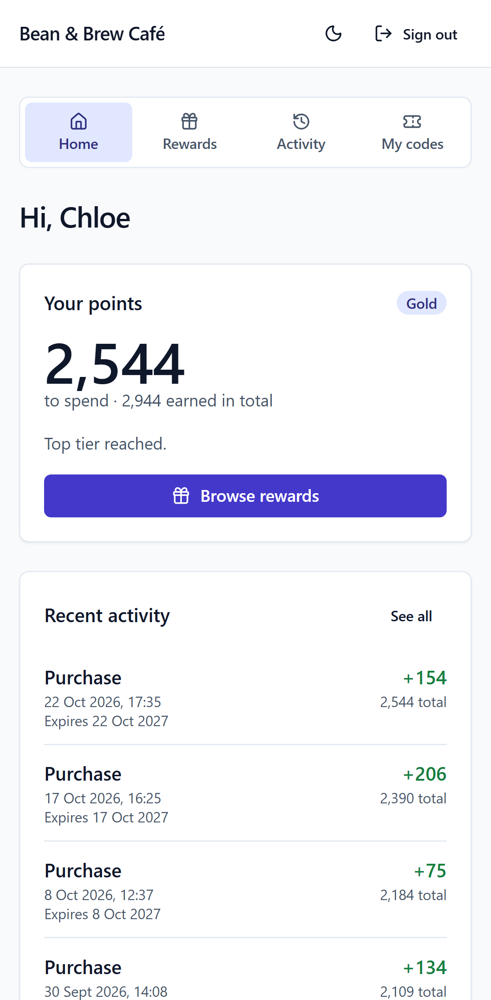
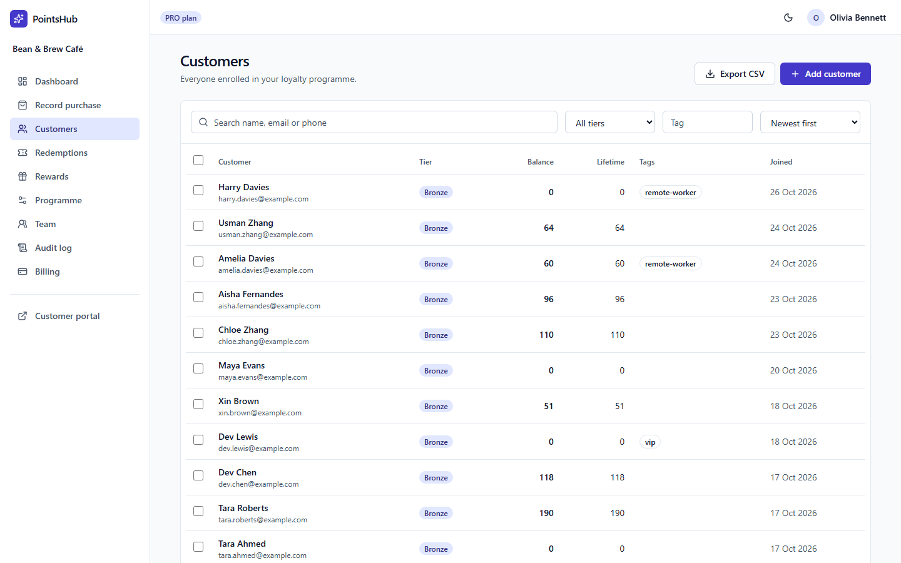
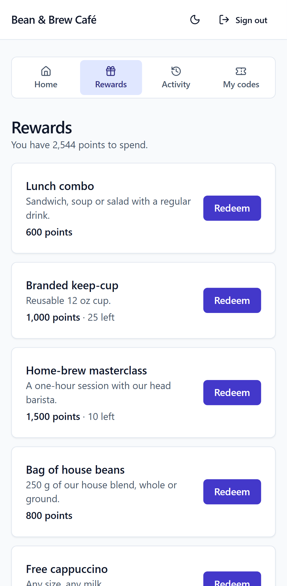
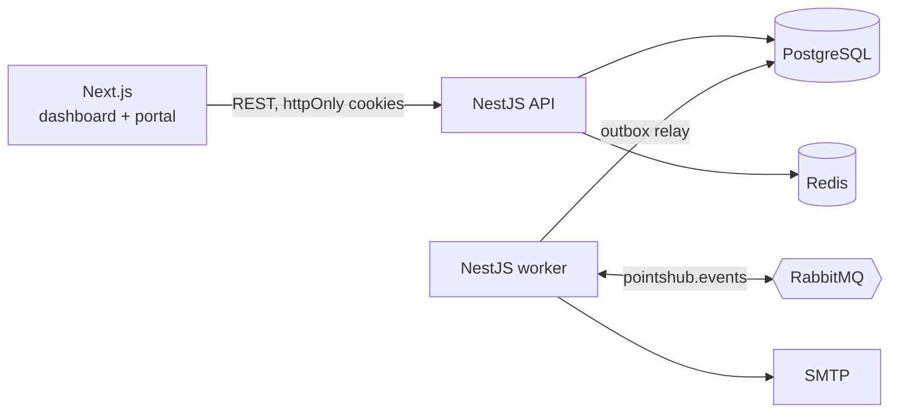

# PointsHub

[](https://github.com/lavitsamson/pointshub-loyalty-saas/actions/workflows/ci.yml)

**Multi-tenant loyalty and rewards platform for cafés, salons and local shops.**
Staff record purchases, customers earn points and climb tiers, and owners see what keeps their
regulars coming back.

**Live demo:** coming soon — the deployment is described in [docs/DEPLOYMENT.md](docs/DEPLOYMENT.md).
Sign in with the [demo logins](#demo-logins); the demo resets every night.



<table>
  <tr>
    <td width="68%"></td>
    <td width="32%"></td>
  </tr>
  <tr>
    <td></td>
    <td></td>
  </tr>
</table>

Dark mode: [dashboard](docs/images/dashboard-dark.png). Screenshots are regenerated from the
seeded demo with `pnpm screenshots`.

## Features

- **Merchant dashboard** — KPIs and a 30-day chart, customer table with search, filters, bulk
  actions and CSV export, a fast record-purchase flow, rewards, fulfil-by-code redemptions,
  programme settings, team management and an audit log. Responsive, keyboard-accessible, dark mode.
- **Points engine** — tier and campaign multipliers, FIFO expiry, an append-only ledger with a
  tested balance invariant, idempotent purchases and overspend-proof redemptions.
- **Customer portal** — each business's own rewards page: join online or claim an account
  made at the till via an emailed link, see balance, tier progress and history, redeem rewards
  for a code to show at the counter. Mobile-first; sessions only work at the business that issued
  them.
- **Events** — transactional outbox → RabbitMQ → idempotent consumers for customer emails
  and live dashboard stats, with backoff retries and a dead-letter queue; nightly FIFO points
  expiry and "points expiring in 7 days" emails.
- **Billing** — Free and Pro plans on Stripe (test mode): Checkout, the Billing Portal, and
  signature-verified webhooks applied exactly once and in the right order. The Free plan's
  100-customer limit is enforced under a lock, with an upgrade prompt in the dashboard.
- **Production-ready packaging** — one multi-stage Dockerfile builds small, non-root images
  for each app; the whole stack (with automatic HTTPS) runs from one Compose file, smoke-tested
  in CI.

### Proposed features

- **Ask your data** — plain-language analytics for owners on the Pro plan, backed by a fixed
  set of tenant-scoped tools so the model never writes SQL. Scoped in
  [docs/PROGRESS.md](docs/PROGRESS.md#proposed-features); not built yet.

## Architecture



More detail in [docs/ARCHITECTURE.md](docs/ARCHITECTURE.md).

## Tech stack

| Area              | Choice                                                                                         |
| ----------------- | ---------------------------------------------------------------------------------------------- |
| Monorepo          | pnpm workspaces, Turborepo                                                                     |
| Language          | TypeScript (strict, `noUncheckedIndexedAccess`)                                                |
| Web               | Next.js (App Router), React, Tailwind CSS, Radix UI, TanStack Query, react-hook-form, Recharts |
| API / worker      | NestJS, zod validation, OpenAPI                                                                |
| Data              | PostgreSQL, Prisma                                                                             |
| Messaging / cache | RabbitMQ, Redis                                                                                |
| Observability     | pino structured logs with request ids, health and readiness probes                             |
| Testing           | Jest, Supertest, Testcontainers, Playwright                                                    |
| CI                | GitHub Actions                                                                                 |
| Deployment        | Docker, Docker Compose, Caddy                                                                  |

## Getting started

Prerequisites: Node.js 24, pnpm 12 (`corepack enable`), Docker.

```bash
pnpm install
cp .env.example .env
docker compose up -d
pnpm db:setup   # apply migrations and load demo data
pnpm dev
```

### Demo logins

All demo accounts use the password `DemoPass123!`.

| Login                    | Business                       | Role  |
| ------------------------ | ------------------------------ | ----- |
| `owner@beanbrew.demo`    | Bean & Brew Café (PRO plan)    | Owner |
| `staff@beanbrew.demo`    | Bean & Brew Café               | Staff |
| `owner@studiobloom.demo` | Studio Bloom Salon (FREE plan) | Owner |

The customer side is at http://localhost:3000/c/bean-and-brew: sign in as
`customer@beanbrew.demo`, a Gold-tier regular with points to spend. Staff find their own
business's portal link in the dashboard navigation ("Customer portal").

`pnpm db:seed` recreates the demo businesses from scratch and can be re-run at any time.

| Service                  | URL                                                |
| ------------------------ | -------------------------------------------------- |
| Web app                  | http://localhost:3000                              |
| API                      | http://localhost:4000/api/v1                       |
| API docs (OpenAPI)       | http://localhost:4000/api/docs                     |
| RabbitMQ management      | http://localhost:15672 (`pointshub` / `pointshub`) |
| Mailpit (captured email) | http://localhost:8025                              |

### Billing (optional)

Everything above works without Stripe: the billing page then says billing is not set up, and
the demo businesses keep their seeded plans. To try upgrades with a
[Stripe test account](https://dashboard.stripe.com/test):

1. Create a product with a monthly recurring price, and enable the
   [customer portal](https://dashboard.stripe.com/test/settings/billing/portal).
2. Forward webhooks to the API (the
   [Stripe CLI](https://docs.stripe.com/stripe-cli) prints a `whsec_...` signing secret):

   ```bash
   stripe listen --forward-to localhost:4000/api/v1/webhooks/stripe \
     --events checkout.session.completed,customer.subscription.updated,customer.subscription.deleted,invoice.payment_failed
   ```

3. Set `STRIPE_SECRET_KEY` (`sk_test_...`), `STRIPE_WEBHOOK_SECRET` and `STRIPE_PRO_PRICE_ID`
   in `.env`, and restart `pnpm dev`.
4. Sign in as `owner@studiobloom.demo`, open **Billing** and upgrade with the test card
   `4242 4242 4242 4242` (any future expiry, any CVC).

## Commands

| Command               | What it does                                                                                                 |
| --------------------- | ------------------------------------------------------------------------------------------------------------ |
| `pnpm dev`            | Runs web, API and worker in watch mode                                                                       |
| `pnpm build`          | Builds every package                                                                                         |
| `pnpm lint`           | ESLint across the workspace                                                                                  |
| `pnpm typecheck`      | `tsc --noEmit` across the workspace                                                                          |
| `pnpm test`           | Unit tests                                                                                                   |
| `pnpm test:int`       | API and worker integration tests against real Postgres, Redis and RabbitMQ (Testcontainers; Docker required) |
| `pnpm test:e2e`       | Playwright end-to-end tests                                                                                  |
| `pnpm db:migrate`     | Creates/applies migrations in development                                                                    |
| `pnpm db:deploy`      | Applies committed migrations (CI, production)                                                                |
| `pnpm db:seed`        | Recreates the demo businesses (safe to re-run)                                                               |
| `pnpm db:seed:perf`   | Loads the performance dataset: one business with 50,000 customers                                            |
| `pnpm perf:customers` | Benchmarks the customer list against the performance dataset (API must be running)                           |
| `pnpm screenshots`    | Regenerates the README screenshots from the seeded demo                                                      |

## Testing

- **Unit** tests sit next to the code (`*.spec.ts` / `*.test.ts`) and need no services.
- **Integration** tests (`apps/api/test/*.int-spec.ts`) start throwaway containers, apply the
  real migrations and exercise the API through HTTP with the production middleware stack. The
  worker's (`apps/worker/test`) run the real relay and consumers against a real broker: outbox to
  stats end to end, duplicate deliveries, retries into the dead-letter queue, concurrent relays,
  and the expiry jobs.
- **End-to-end** tests (`apps/web/e2e`) start the built API and web app and drive them in Chromium
  (plus a phone viewport for public pages and the portal): a new business signs up through the
  emailed link, sets up its programme, adds a customer and records a purchase; the customer joins the portal through the emailed link
  (read from Mailpit) and redeems a reward; staff fulfil it by code. There are also
  bulk-action, portal sign-up and billing-page flows, a security-headers check, and an
  accessibility scan (axe-core, WCAG 2.2 A/AA) of every page in light and dark themes plus
  keyboard focus checks. They need `docker compose up -d`, `pnpm db:deploy` and `pnpm db:seed`
  first.

## Performance

The customer list was measured against one business with **50,000 customers and 500,071
ledger entries** (`pnpm db:seed:perf`). `pnpm perf:customers` sends 50 sequential requests per
scenario through the real HTTP API (session, tenant guard, validation, serialisation), 25 rows a
page, and fails if any p95 exceeds the 300 ms budget. Run locally on Windows 11 with
PostgreSQL 17 in Docker Desktop:

| Scenario                      | p95 before | p95 after |
| ----------------------------- | ---------: | --------: |
| Newest first (default)        |     8.9 ms |    8.7 ms |
| Sorted by name                |    20.3 ms |    5.4 ms |
| Sorted by points              |    15.5 ms |    5.5 ms |
| Page 20 (keyset cursor)       |    10.9 ms |    7.0 ms |
| Search, common name           |    10.9 ms |   12.3 ms |
| Search by email fragment      |    72.5 ms |    8.2 ms |
| Search, no match              |    70.2 ms |    4.8 ms |
| Filter by tag                 |     6.3 ms |    6.4 ms |
| Tag filter + sorted by points |    18.9 ms |    8.7 ms |
| Customer's points history     |     6.4 ms |    6.8 ms |

Every case was within budget before, but the query plans showed why some were slower: sorting
by name or points, searching and filtering by tag read all 50,000 of the business's rows, so
they would keep growing with it. The indexes added:

- `(tenantId, name, id)` and `(tenantId, pointsBalance DESC, id DESC)`, matching the keyset
  orders, so a page reads about 25 index entries however large the business is.
- Trigram GIN indexes (`pg_trgm`) on name, email and phone for substring search, and a GIN
  index on tags. A search with no match now reads no rows instead of all of them.

Loading the dataset found a worse problem: **deleting a business took 151 seconds**. Foreign
keys from the ledger to purchases and redemptions had no index, so every cascaded delete scanned
the whole ledger, and the per-customer indexes led with `tenantId`, so per-customer cascades
could not use them. With indexes on the ledger's foreign keys, and the customer-history indexes
led by `customerId` (unique, so `tenantId` becomes a cheap filter), the same delete takes
**0.1 seconds**.

## Deployment

The demo runs on a single VM: `deploy/compose.yml` starts the web app, API, worker,
PostgreSQL, Redis, RabbitMQ and Mailpit behind Caddy, which handles HTTPS. Only Caddy is
exposed. Migrations run as a one-off job before the API starts, and a cron job wipes and
re-seeds the demo every night. Step-by-step setup, updates and operations are in
[docs/DEPLOYMENT.md](docs/DEPLOYMENT.md).

## Design decisions

- [ADR 0001 — Multi-tenancy](docs/adr/0001-multi-tenancy.md): one shared database with a
  `tenantId` on every row, enforced by a route guard, a Prisma extension and an isolation test suite.
- [ADR 0002 — Authentication and sessions](docs/adr/0002-authentication-and-sessions.md):
  15-minute JWTs and rotating refresh tokens in httpOnly cookies, with reuse detection that
  revokes the whole session family; roles are checked per request so changes apply instantly.
  Sign-up finishes from an emailed link, so it never reveals who already has an account.
- [ADR 0003 — Points ledger](docs/adr/0003-points-ledger.md): an append-only ledger (enforced by a
  trigger) with a cached balance updated under a row lock; idempotent purchases and exact decimal
  maths, proven by a 200-operation invariant test and concurrent-redemption tests.

- [ADR 0004 — Web app API access](docs/adr/0004-web-app-api-access.md): the browser talks only to
  the web origin, which forwards `/api/v1` to the API; session renewal is single-flight across
  requests and tabs so rotating refresh tokens never trip reuse detection.
- [ADR 0005 — Transactional outbox](docs/adr/0005-transactional-outbox.md): events are written
  in the same transaction as the change and relayed to RabbitMQ with `SKIP LOCKED`; consumers
  deduplicate via `ProcessedEvent` and back off through retry queues into a dead-letter queue.
- [ADR 0006 — Customer portal sessions](docs/adr/0006-customer-portal-sessions.md): portal tokens
  name their business and cookies are path-scoped to one portal; joining always answers with an
  emailed link, so the portal never reveals who is a customer and an account made at the till can
  only be claimed by its owner.
- [ADR 0007 — Billing and plan limits](docs/adr/0007-billing-and-plan-limits.md): only
  signature-verified Stripe webhooks change a plan; each is recorded once and re-reads the
  subscription under a tenant lock, so duplicates and out-of-order events cannot misapply.
- [ADR 0008 — Single-host demo deployment](docs/adr/0008-single-host-demo-deployment.md): one
  VM running Docker Compose behind Caddy, built from one multi-stage Dockerfile; demo email goes
  to a public Mailpit inbox and the data resets nightly.

Smaller decisions worth knowing:

- **Supply-chain guard.** `pnpm-workspace.yaml` sets `minimumReleaseAge` to 14 days and dependency
  install scripts are opt-in.
- **TypeScript 6.** TypeScript 7 is available, but typescript-eslint, ts-jest and `@nestjs/swagger`
  do not support it yet.

## Security

[docs/SECURITY.md](docs/SECURITY.md) lists the threats considered (tenant data leakage, IDOR,
account enumeration, credential attacks, token theft, CSRF and clickjacking, webhook spoofing,
points fraud) with the mitigation and the tests for each, and the risks accepted.

## How I used AI

See [docs/AI_USAGE.md](docs/AI_USAGE.md).

## Author

**Lavit Samson** — Senior Full-Stack Engineer · [linkedin.com/in/lavit-samson](https://linkedin.com/in/lavit-samson)
