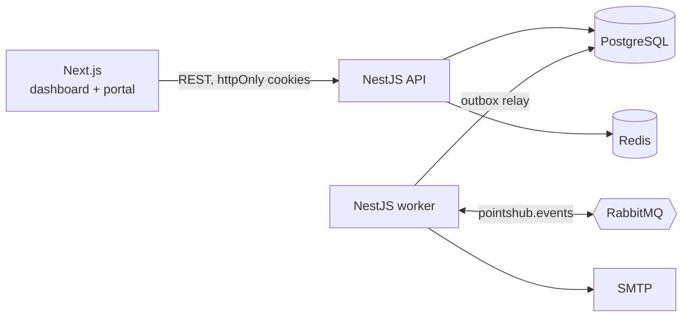

# PointsHub

[](https://github.com/lavitsamson/pointshub-loyalty-saas/actions/workflows/ci.yml)

**Multi-tenant loyalty and rewards platform for cafés, salons and local shops.**
Staff record purchases, customers earn points and climb tiers, and owners see what keeps their
regulars coming back.

> Status: in active development — see [progress](docs/PROGRESS.md).

## Features

Built so far are the merchant dashboard, points engine, event pipeline and customer portal; the
rest is tracked in [docs/PROGRESS.md](docs/PROGRESS.md).

- **Merchant dashboard** ✅ — KPIs and a 30-day chart, customer table with search, filters, bulk
  actions and CSV export, a fast record-purchase flow, rewards, fulfil-by-code redemptions,
  programme settings, team management and an audit log. Responsive, keyboard-accessible, dark mode.
- **Points engine** ✅ — tier and campaign multipliers, FIFO expiry, an append-only ledger with a
  tested balance invariant, idempotent purchases and overspend-proof redemptions.
- **Customer portal** ✅ — each business's own rewards page: join online or claim an account
  made at the till via an emailed link, see balance, tier progress and history, redeem rewards
  for a code to show at the counter. Mobile-first; sessions only work at the business that issued
  them.
- **Events** ✅ — transactional outbox → RabbitMQ → idempotent consumers for customer emails
  and live dashboard stats, with backoff retries and a dead-letter queue; nightly FIFO points
  expiry and "points expiring in 7 days" emails.
- **Billing** — Stripe Checkout, Billing Portal and verified, de-duplicated webhooks (test mode).
- **Ask your data** — plain-language analytics backed by a fixed set of tenant-scoped tools; the
  model never writes SQL.

## Architecture



More detail in [docs/ARCHITECTURE.md](docs/ARCHITECTURE.md).

## Tech stack

| Area              | Choice                                                                                         |
| ----------------- | ---------------------------------------------------------------------------------------------- |
| Monorepo          | pnpm workspaces, Turborepo                                                                     |
| Language          | TypeScript (strict, `noUncheckedIndexedAccess`)                                                |
| Web               | Next.js (App Router), React, Tailwind CSS, Radix UI, TanStack Query, react-hook-form, Recharts |
| API / worker      | NestJS, zod validation, OpenAPI                                                                |
| Data              | PostgreSQL, Prisma                                                                             |
| Messaging / cache | RabbitMQ, Redis                                                                                |
| Observability     | pino structured logs with request ids, health and readiness probes                             |
| Testing           | Jest, Supertest, Testcontainers, Playwright                                                    |
| CI                | GitHub Actions                                                                                 |

## Getting started

Prerequisites: Node.js 24, pnpm 12 (`corepack enable`), Docker.

```bash
pnpm install
cp .env.example .env
docker compose up -d
pnpm db:setup   # apply migrations and load demo data
pnpm dev
```

### Demo logins

All demo accounts use the password `DemoPass123!`.

| Login                    | Business                       | Role  |
| ------------------------ | ------------------------------ | ----- |
| `owner@beanbrew.demo`    | Bean & Brew Café (PRO plan)    | Owner |
| `staff@beanbrew.demo`    | Bean & Brew Café               | Staff |
| `owner@studiobloom.demo` | Studio Bloom Salon (FREE plan) | Owner |

The customer side is at http://localhost:3000/c/bean-and-brew: sign in as
`customer@beanbrew.demo`, a Gold-tier regular with points to spend. Staff find their own
business's portal link in the dashboard navigation ("Customer portal").

`pnpm db:seed` recreates the demo businesses from scratch and can be re-run at any time.

| Service                  | URL                                                |
| ------------------------ | -------------------------------------------------- |
| Web app                  | http://localhost:3000                              |
| API                      | http://localhost:4000/api/v1                       |
| API docs (OpenAPI)       | http://localhost:4000/api/docs                     |
| RabbitMQ management      | http://localhost:15672 (`pointshub` / `pointshub`) |
| Mailpit (captured email) | http://localhost:8025                              |

## Commands

| Command           | What it does                                                                                                 |
| ----------------- | ------------------------------------------------------------------------------------------------------------ |
| `pnpm dev`        | Runs web, API and worker in watch mode                                                                       |
| `pnpm build`      | Builds every package                                                                                         |
| `pnpm lint`       | ESLint across the workspace                                                                                  |
| `pnpm typecheck`  | `tsc --noEmit` across the workspace                                                                          |
| `pnpm test`       | Unit tests                                                                                                   |
| `pnpm test:int`   | API and worker integration tests against real Postgres, Redis and RabbitMQ (Testcontainers; Docker required) |
| `pnpm test:e2e`   | Playwright end-to-end tests                                                                                  |
| `pnpm db:migrate` | Creates/applies migrations in development                                                                    |
| `pnpm db:deploy`  | Applies committed migrations (CI, production)                                                                |

## Testing

- **Unit** tests sit next to the code (`*.spec.ts` / `*.test.ts`) and need no services.
- **Integration** tests (`apps/api/test/*.int-spec.ts`) start throwaway containers, apply the
  real migrations and exercise the API through HTTP with the production middleware stack. The
  worker's (`apps/worker/test`) run the real relay and consumers against a real broker: outbox to
  stats end to end, duplicate deliveries, retries into the dead-letter queue, concurrent relays,
  and the expiry jobs.
- **End-to-end** tests (`apps/web/e2e`) start the built API and web app and drive them in Chromium
  (plus a phone viewport for public pages and the portal): a new business sets up its programme,
  adds a customer and records a purchase; the customer joins the portal through the emailed link
  (read from Mailpit) and redeems a reward; staff fulfil it by code. There is also a
  bulk-action flow and a portal sign-up flow. They need `docker compose up -d` and
  `pnpm db:deploy` first.

## Design decisions

- [ADR 0001 — Multi-tenancy](docs/adr/0001-multi-tenancy.md): one shared database with a
  `tenantId` on every row, enforced by a route guard, a Prisma extension and an isolation test suite.
- [ADR 0002 — Authentication and sessions](docs/adr/0002-authentication-and-sessions.md):
  15-minute JWTs and rotating refresh tokens in httpOnly cookies, with reuse detection that
  revokes the whole session family; roles are checked per request so changes apply instantly.
- [ADR 0003 — Points ledger](docs/adr/0003-points-ledger.md): an append-only ledger (enforced by a
  trigger) with a cached balance updated under a row lock; idempotent purchases and exact decimal
  maths, proven by a 200-operation invariant test and concurrent-redemption tests.

- [ADR 0004 — Web app API access](docs/adr/0004-web-app-api-access.md): the browser talks only to
  the web origin, which forwards `/api/v1` to the API; session renewal is single-flight across
  requests and tabs so rotating refresh tokens never trip reuse detection.
- [ADR 0005 — Transactional outbox](docs/adr/0005-transactional-outbox.md): events are written
  in the same transaction as the change and relayed to RabbitMQ with `SKIP LOCKED`; consumers
  deduplicate via `ProcessedEvent` and back off through retry queues into a dead-letter queue.
- [ADR 0006 — Customer portal sessions](docs/adr/0006-customer-portal-sessions.md): portal tokens
  name their business and cookies are path-scoped to one portal; joining always answers with an
  emailed link, so the portal never reveals who is a customer and an account made at the till can
  only be claimed by its owner.

Smaller decisions worth knowing:

- **Supply-chain guard.** `pnpm-workspace.yaml` sets `minimumReleaseAge` to 14 days and dependency
  install scripts are opt-in.
- **TypeScript 6.** TypeScript 7 is available, but typescript-eslint, ts-jest and `@nestjs/swagger`
  do not support it yet.

## How I used AI

See [docs/AI_USAGE.md](docs/AI_USAGE.md).

## Author

**Lavit Samson** — Senior Full-Stack Engineer · [linkedin.com/in/lavit-samson](https://linkedin.com/in/lavit-samson)
