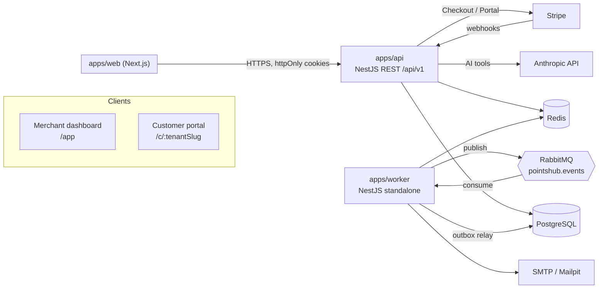
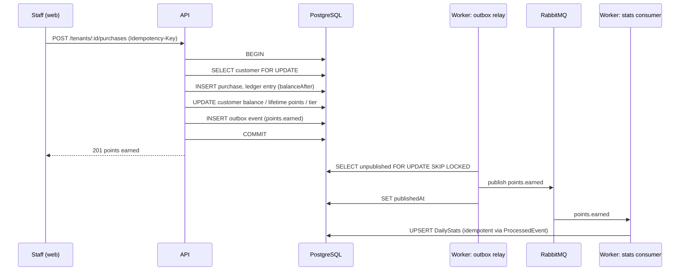

# Architecture

## System overview

## Components

| Component         | Responsibility                                                                                                                                 |
| ----------------- | ---------------------------------------------------------------------------------------------------------------------------------------------- |
| `apps/web`        | Merchant dashboard and customer portal. Talks only to the API.                                                                                 |
| `apps/api`        | REST API. Authentication, authorisation, tenant scoping, all writes. Writes domain events to the outbox in the same transaction as the change. |
| `apps/worker`     | Background work: outbox relay → RabbitMQ, event consumers (notifications, daily stats), scheduled jobs (points expiry).                        |
| `packages/shared` | zod schemas and types shared by API and web: request/response contracts, enums, event envelope, Problem Details.                               |
| `packages/db`     | Prisma schema, migrations and the client factory.                                                                                              |
| `packages/config` | Shared TypeScript, ESLint and Prettier configuration.                                                                                          |

## Key flows

### Recording a purchase

## Cross-cutting concerns

- **Multi-tenancy:** shared tables with `tenantId`; see [ADR 0001](adr/0001-multi-tenancy.md).
- **Errors:** every error response is RFC 9457 Problem Details (`application/problem+json`).
- **Validation:** zod schemas from `packages/shared`, applied by a Nest validation pipe.
- **Logging:** structured JSON via pino; every request carries an `x-request-id` that is accepted
  from upstream or generated, and echoed back.
- **Health:** `GET /api/v1/health/live` (process up) and `GET /api/v1/health/ready` (database,
  Redis and RabbitMQ reachable, each with a 2 s timeout).
- **Ledger integrity:** `PointsLedgerEntry` is append-only, enforced by a database trigger as well
  as by application code.
