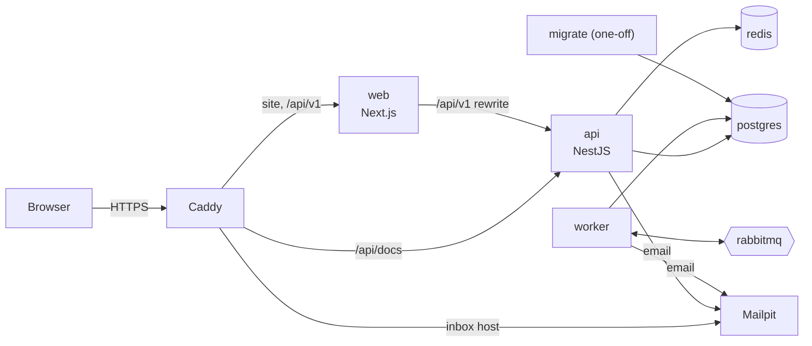

# Deployment

The public demo runs on one virtual machine with Docker Compose, behind Caddy for HTTPS. Why
this shape, and what it gives up, is in
[ADR 0008](adr/0008-single-host-demo-deployment.md).



Only Caddy publishes ports (80 and 443). Everything else is reachable only on the Compose
network.

## Images

One multi-stage [`Dockerfile`](../Dockerfile) builds the monorepo once and produces an image per
app:

| Target   | Contents                                                     | Runs                      |
| -------- | ------------------------------------------------------------ | ------------------------- |
| `api`    | Compiled API and its production dependencies (`pnpm deploy`) | `node dist/main.js`       |
| `worker` | Compiled worker and its production dependencies              | `node dist/main.js`       |
| `web`    | Next.js standalone server and static assets                  | `node apps/web/server.js` |
| `tools`  | The full workspace: Prisma CLI, migrations, the seed         | `pnpm migrate:deploy`     |

All images run on `node:24-slim` as the unprivileged `node` user; `api` and `web` have Docker
health checks.

The web app's `/api/v1` rewrite target and public variables are fixed at build time:

| Build argument               | Default           | Purpose                                                 |
| ---------------------------- | ----------------- | ------------------------------------------------------- |
| `API_URL`                    | `http://api:4000` | Where the web server forwards `/api/v1`                 |
| `NEXT_PUBLIC_DEMO_INBOX_URL` | empty             | When set, "Check your email" screens link to this inbox |

```bash
docker build --target api -t pointshub-api .
docker build --target web -t pointshub-web --build-arg API_URL=http://api:4000 .
```

## Configuration

The server needs one file, `deploy/.env` (template: [`deploy/.env.example`](../deploy/.env.example)):

| Variable                                                            | Notes                                                     |
| ------------------------------------------------------------------- | --------------------------------------------------------- |
| `DOMAIN`                                                            | The site, e.g. `pointshub.example.com`                    |
| `INBOX_DOMAIN`                                                      | The public demo inbox, e.g. `mail.pointshub.example.com`  |
| `POSTGRES_PASSWORD`, `RABBITMQ_PASSWORD`                            | `openssl rand -hex 32`                                    |
| `JWT_SECRET`                                                        | `openssl rand -hex 32`; the API refuses the example value |
| `STRIPE_SECRET_KEY`, `STRIPE_WEBHOOK_SECRET`, `STRIPE_PRO_PRICE_ID` | Optional, test mode only; all three or none               |

Everything else (service URLs, `NODE_ENV=production`, `COOKIE_SECURE=true`,
`TRUST_PROXY_HOPS=1`) is set in [`deploy/compose.yml`](../deploy/compose.yml).

## First deployment

Tested with Ubuntu 24.04 on a 2 vCPU / 4 GB machine (for example a Hetzner CX22).

1. **DNS.** Point A (and AAAA) records for `DOMAIN` and `INBOX_DOMAIN` at the server.

2. **Server.** Install Docker Engine with the Compose plugin
   ([instructions](https://docs.docker.com/engine/install/ubuntu/)) and allow only SSH and web
   traffic:

   ```bash
   ufw allow OpenSSH && ufw allow 80,443/tcp && ufw allow 443/udp && ufw enable
   ```

   Docker publishes ports through its own iptables rules, which bypass ufw; that is why the
   Compose file publishes nothing but Caddy's.

3. **Code and secrets.**

   ```bash
   git clone https://github.com/lavitsamson/pointshub-loyalty-saas.git /opt/pointshub
   cd /opt/pointshub/deploy
   cp .env.example .env && chmod 600 .env   # then fill it in
   ```

4. **Start.** The first build takes a few minutes. Migrations run before the API and worker
   start; Caddy fetches certificates on the first request.

   ```bash
   docker compose up -d --build --wait
   docker compose run --rm seed    # load the demo businesses
   ```

5. **Check.**

   ```bash
   curl https://$DOMAIN/api/v1/health/ready
   # {"status":"ok","checks":{"database":"up","redis":"up","rabbitmq":"up"}}
   ```

   Then sign in as `owner@beanbrew.demo` / `DemoPass123!`.

## Nightly demo reset

`seed:wipe` truncates every table except the migration history and recreates the demo
businesses, so anything visitors made disappears. Run it from the host's crontab
(`crontab -e`), at 03:00 server time:

```cron
0 3 * * * cd /opt/pointshub/deploy && docker compose run --rm seed >> /var/log/pointshub-reset.log 2>&1
```

Requests during the few seconds of the reset may fail; the demo says it resets nightly.

## Updating

```bash
cd /opt/pointshub && git pull
cd deploy && docker compose up -d --build --wait
```

Compose rebuilds the images, runs `migrate` again (a no-op without new migrations) and replaces
the containers whose image changed. Migrations must stay backwards compatible with the running
code for the few seconds between the migration and the API restart (add columns before using
them; drop them a release later).

To roll back, check out the previous commit and run the same command. Migrations are not rolled
back automatically; a migration that needs undoing gets a new migration.

## Stripe (optional)

Create a webhook endpoint in the Stripe dashboard (test mode) for
`https://<DOMAIN>/api/v1/webhooks/stripe` with the events `checkout.session.completed`,
`customer.subscription.updated`, `customer.subscription.deleted` and `invoice.payment_failed`.
Put its signing secret and the test keys in `deploy/.env` and run `docker compose up -d`.

## Operations

| Task                       | Command (in `deploy/`)                                                                          |
| -------------------------- | ----------------------------------------------------------------------------------------------- |
| Status                     | `docker compose ps`                                                                             |
| Logs (JSON, one line each) | `docker compose logs -f api worker`                                                             |
| Database shell             | `docker compose exec postgres psql -U pointshub`                                                |
| Backup                     | `docker compose exec -T postgres pg_dump -U pointshub -Fc pointshub > pointshub.dump`           |
| Restore                    | `docker compose exec -T postgres pg_restore -U pointshub -d pointshub --clean < pointshub.dump` |
| Dead-lettered messages     | `docker compose exec rabbitmq rabbitmqctl list_queues name messages`                            |

The demo is reset nightly, so it takes no scheduled backups. A real deployment would, or would
use a managed PostgreSQL with point-in-time recovery.

## Trying the stack locally

The same Compose file runs on a laptop. Caddy serves `localhost` with a certificate from its
own local authority (the browser warns once):

```bash
cd deploy
printf 'DOMAIN=localhost\nINBOX_DOMAIN=mail.localhost\nPOSTGRES_PASSWORD=%s\nRABBITMQ_PASSWORD=%s\nJWT_SECRET=%s\n' \
  "$(openssl rand -hex 32)" "$(openssl rand -hex 32)" "$(openssl rand -hex 32)" > .env
docker compose up -d --build --wait && docker compose run --rm seed
```

Open https://localhost and https://mail.localhost. It needs ports 80 and 443 free; the
development stack (`docker compose up -d` at the repository root) is a separate Compose project
and can run alongside. CI runs this stack and smoke-tests it on every push.

`docker compose down -v` removes it, data included.
